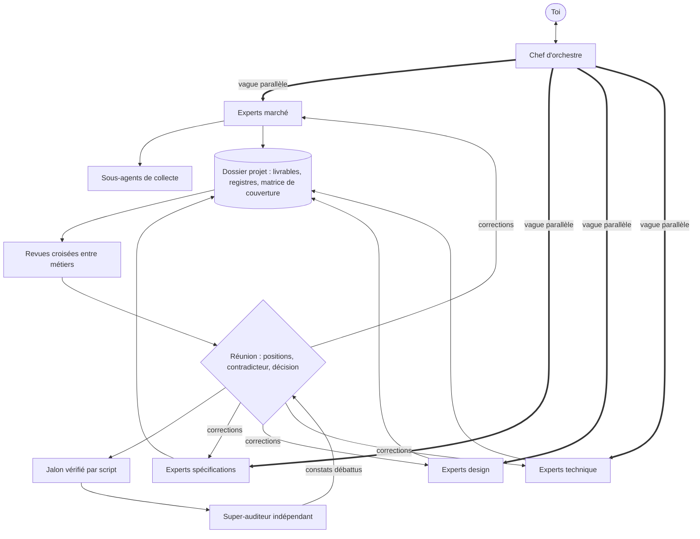

<h1 align="center">Dan-Cortex</h1>

<p align="center"><strong>Le réseau d'agents experts qui lance vos projets numériques avec Claude.</strong></p>

<p align="center">
  <a href="https://github.com/aksilsmd/claude-code-autonomy-lab/actions/workflows/tests.yml"></a>
  
  
  
  
  
  
</p>

Dan-Cortex est un plugin pour Claude. Il organise 59 agents experts comme les équipes d'une vraie
entreprise pour cadrer, concevoir, réaliser, tester, sécuriser et lancer un projet numérique : site web de grande
entreprise, application mobile, SaaS, produit de niche, e-commerce, ERP. Les agents travaillent en parallèle, se
relisent entre métiers, débattent des décisions structurantes, et un auditeur indépendant passe tout en revue
avant le lancement. Une matrice de 784 contrôles garantit que rien n'est oublié : technique,
sécurité, juridique, pénal, financier, marketing, social, culturel, politique.

**Nouveau en 1.0 :** Dan-Cortex peut mener tout le projet **en autonomie** dans un cadre que tu fixes une fois,
et il intègre **Claude Code Autonomy Lab** : un pôle de robustesse des agents qui audite les réglages Claude Code
et éprouve les fonctions d'IA contre l'injection d'instructions.

> Dan-Cortex prépare, vérifie et rédige. Il ne remplace ni un avocat, ni un expert-comptable, ni un auditeur de
> sécurité qualifié : ce qui engage est marqué « à valider ».

**Nouveau en 1.3.0 :** deux skills transversaux renforcent l'exécution résiliente (récupération après erreur et vérification des résultats) et la confidentialité (masquage des secrets et données personnelles), sans contourner les permissions ni falsifier les journaux d'audit.

**Nouveau en 2.2 :** le réseau compte 48 skills et 59 agents. Il couvre en plus le recueil du besoin par interview, le design de niveau Apple et le mouvement d'interface, la boîte à outils IT locale, la cartographie du code en graphe, le CRM libre Twenty, l'atelier d'écriture et l'édition, la traduction et l'interprétariat (FR/AR/EN), le studio 3D et jeu vidéo, la 3D web immersive, les médias générés par IA, la plateforme e-learning et la reconstruction en salle blanche. Une bibliothèque de 173 skills vendorisés (`dan-cortex/bibliotheque/`) est chargée à la demande, jamais au démarrage de la session.

## Sommaire

| | |
|---|---|
| [Installer](#installer) · [Démarrer](#démarrer) · [Le mode autonome](#le-mode-autonome) | prendre le plugin en main |
| [Comment ça marche](#comment-ça-marche) · [Les pôles](#les-pôles) · [Les autres skills](#les-autres-skills) | ce que fait le réseau, et les 48 commandes |
| [Sobriété en tokens](#sobriété-en-tokens) · [État de validation](#état-de-validation) · [Limites](#limites) | ce que ça coûte, ce qui est vérifié, ce qui ne l'est pas |
| [Contenu du dépôt](#contenu-du-dépôt) · [Gouvernance](#gouvernance) · [Licence](#licence) | travailler sur le dépôt |

## Installer

**Dans Claude Code**

```
/plugin marketplace add aksilsmd/cortex
/plugin install dan-cortex@cortex-projets
```

**Dans l'application Claude** (web et bureau, offres payantes)

1. Ouvre le menu **Customize** (Personnaliser), onglet **Plugins**.
2. Clique sur **Add** → **Add marketplace** → **Add from a repository**, puis saisis `aksilsmd/cortex`.
3. Sélectionne le plugin **dan-cortex** et clique sur **Add**.

Autre voie : télécharge [`dist/dan-cortex.plugin`](dist/dan-cortex.plugin) et téléverse-le comme plugin personnalisé.
Si l'ancien plugin `cortex` est installé, retire-le : les deux portent les mêmes skills et les mêmes agents.
Les libellés du menu peuvent être traduits dans ton application.

Prérequis : Python 3 pour les scripts de pilotage (bibliothèque standard uniquement).

## Démarrer

```
/dan-cortex:lancer-projet Je veux lancer <ton projet>, pour <qui>, dans <quels pays>, avec <budget et délai>.
```

Le chef d'orchestre pose une seule série de questions, crée le dossier du projet, compose l'équipe et déroule
les jalons. Tu peux t'arrêter à n'importe lequel.

| Jalon | Question tranchée |
|---|---|
| J1 Opportunité | Faut-il y aller, et sous quel angle ? |
| J2 Cadrage | Quoi, pour qui, combien, quand ? |
| J3 Conception | Comment exactement ? |
| J4 Réalisation | Est-ce construit et testé ? |
| J5 Validation | Est-ce prêt ? |
| J6 Lancement | Lancer et tenir |
| J7 Bilan | Qu'a-t-on appris ? |

Trois modes règlent l'ampleur et le coût : `eclair` (3 à 4 agents par vague, contrôles bloquants seulement),
`standard` (6 à 8), `integral` (10 à 16, pour les grands comptes et les secteurs régulés).

## Le mode autonome

Trois niveaux d'autonomie règlent quand le chef d'orchestre s'arrête pour te consulter :

| Niveau | Ce qui se passe |
|---|---|
| `accompagne` (par défaut) | arrêt à chaque jalon, décisions irréversibles soumises sur le moment |
| `delegue` | les jalons s'enchaînent, tes décisions sont regroupées à la fin de chacun |
| `autonome` | après la qualification, tout le périmètre s'enchaîne sans attendre ; un seul bilan final |

En `autonome`, le réseau tranche les décisions irréversibles au statut **provisoire** (option la plus facile à
défaire, repli et coût d'annulation notés), remplace les questions par des hypothèses écrites, répare deux fois
avant de s'arrêter sur un jalon bloqué, et n'agit hors de l'espace de travail que dans les **autorisations
permanentes** que tu as écrites à J0 (par exemple « push sur la branche `dev` de tel dépôt »).

Six **limites dures** ne se délèguent jamais : dépenser ou t'engager, toucher un système qui n'est pas au projet,
tester la sécurité sans autorisation écrite, modifier les permissions de Claude Code, supprimer de façon
irréversible, sortir un vrai secret. L'autonomie passe par des réglages Claude Code ciblés (mode `auto`, bac à
sable, commandes dangereuses interdites), fournis par le pôle `robustesse-agents`, pas par un contournement des
permissions.

```
/dan-cortex:lancer-projet Mène en autonomie un SaaS de prise de rendez-vous pour kinés, France, 30 k€, 4 mois.
```

## Comment ça marche



- **Un chef d'orchestre** parle avec toi et lance les agents par vagues parallèles.
- **Des orchestrateurs de pôle** découpent le travail en ordres de mission ; **des sous-agents légers** font la
  collecte et l'exécution.
- **Des réunions écrites** tranchent les choix structurants : positions séparées, contradicteur, deux tours au
  plus, décision tracée. Les décisions irréversibles te reviennent.
- **Des revues croisées** : le juriste relit le marketing, le testeur relit les spécifications, la sécurité
  relit l'architecture.
- **Un super-auditeur** indépendant audite tout avant le lancement ; son rapport est débattu en plénière, puis
  les corrections sont décidées et recontrôlées.
- **Un script** tient les registres, vérifie les jalons, la traçabilité des exigences jusqu'aux tests, et la
  cohérence des interactions : aucun bouton sans destination, aucun écran orphelin.

## Les pôles

| Pôle | Commande | Ce qu'il produit |
|---|---|---|
| Pilotage | `/dan-cortex:lancer-projet` | fiche projet, organigramme, planning, registres, tableau de bord |
| Stratégie et marché | `/dan-cortex:veille-marche` | étude de marché, benchmark des concurrents, voix du client, contexte, positionnement |
| Besoin et spécifications | `/dan-cortex:specifications` | note de cadrage, cahier des charges, spécifications générales, détaillées et techniques |
| Design et expérience | `/dan-cortex:maquettes-parcours` | workflows, matrice d'interactions, maquettes, thème, accessibilité, localisation |
| Architecture et normes | `/dan-cortex:architecture-normes` | choix du langage et de la pile, architecture, schéma de données, normes, infrastructure |
| Réalisation et qualité | `/dan-cortex:usine-logicielle` | code par lots, tests unitaires, fonctionnels, d'API, de bout en bout, recette |
| Sécurité | `/dan-cortex:securite-protection` | analyse de risques, protections, tests de sécurité, cadrage d'un test d'intrusion |
| Juridique et conformité | `/dan-cortex:juridique-conformite` | données personnelles, commerce, contrats, propriété intellectuelle, pénal, fiscalité |
| Finance | `/dan-cortex:budget-finance` | estimation, budget complet, justification économique, financements |
| Marketing et commercial | `/dan-cortex:marketing-commercial` | mise sur le marché, acquisition, prix, vente, plan de lancement |
| Lancement et exploitation | `/dan-cortex:lancement-exploitation` | go/no-go, plan de bascule, mise en production, support, bilan |
| Réunions | `/dan-cortex:reunion-decision` | débat entre experts et décision tracée |
| Audit | `/dan-cortex:audit-general` | audit à 360° d'un projet, mené avec Dan-Cortex ou non |
| Robustesse des agents | `/dan-cortex:robustesse-agents` | audit des réglages Claude Code, réglages pour l'autonomie, scénarios d'injection d'instructions, rapport de robustesse |
| Exécution résiliente | `/dan-cortex:execution-resiliente` | critères d'acceptation, reprise après erreur, poursuite des tâches indépendantes, vérification avant de conclure |
| Confidentialité des traces | `/dan-cortex:confidentialite-traces` | masquage des secrets et données personnelles dans les sorties et journaux, traçabilité préservée |

## Les autres skills

Au-delà des pôles du projet, chaque skill s'utilise aussi seul, rangé ici par famille.

**Recueil du besoin et décision**

| Commande | Ce que tu obtiens |
|---|---|
| `/dan-cortex:accueil-recueil` | premier contact guidé : besoin brut reformulé et validé, exploration, propositions, entretien, étude de réalisation |
| `/dan-cortex:recueil-besoin` | interview adaptée au profil, du besoin brut au cahier des charges |
| `/dan-cortex:vigilance-discernement` | questions de suivi pour vérifier une réponse à décision ¹ |

**Design, interface et mouvement**

| Commande | Ce que tu obtiens |
|---|---|
| `/dan-cortex:design-apple` | design de niveau Apple (règles HIG) pour le web, le mobile et les outils de gestion |
| `/dan-cortex:mouvement-interface` | construire, chorégraphier, fluidifier, auditer et alléger les animations |
| `/dan-cortex:conception-interface` | direction visuelle d'une interface, au-delà des gabarits par défaut ¹ |
| `/dan-cortex:fabrique-themes` | dix thèmes de couleurs et de polices pour un livrable, ou un thème sur mesure ¹ |
| `/dan-cortex:design-affiche` | affiche ou visuel artistique en PNG ou PDF ¹ |

**Outils de réalisation**

| Commande | Ce que tu obtiens |
|---|---|
| `/dan-cortex:cartographie-graphe` | comprendre un code en graphe (Graphify, local) |
| `/dan-cortex:boite-outils-it` | empreintes, secrets de test, TOTP, JWT, QR codes (IT-Tools, local) |
| `/dan-cortex:crm-twenty` | CRM libre Twenty : auto-hébergement sûr, intégration, applications |
| `/dan-cortex:webapp-testing` | tester une application web locale avec Playwright ² |

**Contenus et langues**

| Commande | Ce que tu obtiens |
|---|---|
| `/dan-cortex:atelier-ecriture` | écrire et éditer livres et romans, publier (EPUB/PDF), outils d'aide à l'écriture |
| `/dan-cortex:traduction-interpretariat` | traduire (FR/AR/EN), localiser (RTL, PO/XLIFF), interprétariat |
| `/dan-cortex:communication-interne` | points 3P, lettre d'information, FAQ interne, rapport d'incident ¹ |

**3D, jeu et e-learning**

| Commande | Ce que tu obtiens |
|---|---|
| `/dan-cortex:studio-3d-jeu` | Blender, Maya, ZBrush, Godot, Unity, Unreal, Roblox ; MCP pour Blender ; terrain et cartes (BlenderGIS) ³ |
| `/dan-cortex:web-3d-immersif` | three.js, React Three Fiber, pages « scroll-world », fluide WebGL, portfolio 3D ³ |
| `/dan-cortex:creation-medias-ia` | images, vidéo, audio, textures et assets 3D via Scenario, devis avant génération ³ |
| `/dan-cortex:plateforme-elearning` | choisir, déployer et intégrer un LMS (Canvas LMS, LTI 1.3, API) |
| `/dan-cortex:reconstruction-salle-blanche` | étudier un produit existant et construire sa propre version sans rien copier |

**Documents et médias**

| Commande | Ce que tu obtiens |
|---|---|
| `/dan-cortex:docx` | créer, modifier, relire un .docx ² |
| `/dan-cortex:pdf` | lire, fusionner, remplir, produire des PDF ² |
| `/dan-cortex:pptx` | créer et modifier des .pptx ² |
| `/dan-cortex:xlsx` | créer et recalculer des .xlsx avec formules ² |
| `/dan-cortex:algorithmic-art` | art algorithmique p5.js ² |
| `/dan-cortex:slack-gif-creator` | GIF animés optimisés pour Slack ² |
| `/dan-cortex:brand-guidelines` | exemple : règles de marque d'Anthropic, à ne pas appliquer aux projets des clients ² |

**Écosystème Claude**

| Commande | Ce que tu obtiens |
|---|---|
| `/dan-cortex:claude-api` | bâtir avec l'API et les SDK Claude, migrations de modèles ² |
| `/dan-cortex:mcp-builder` | concevoir et évaluer un serveur MCP ² |
| `/dan-cortex:skill-creator` | écrire, évaluer et améliorer un skill ² |
| `/dan-cortex:web-artifacts-builder` | artefacts HTML riches (React, Tailwind, shadcn/ui) ² |
| `/dan-cortex:academy-guide` | orienter vers les cours de Claude Academy ² |

¹ Texte traduit et adapté d'anthropics/skills (Apache-2.0). ² Copié d'anthropics/skills sans modification
(Apache-2.0) ; ses scripts s'exécutent sur ta machine. ³ Ouvre à la demande la bibliothèque
`dan-cortex/bibliotheque/` (173 compétences vendorisées, MIT). Mentions : `dan-cortex/NOTICE.md` et
`dan-cortex/THIRD_PARTY_NOTICES.md`.

## Sobriété en tokens

Un système multi-agents coûte plus cher qu'une conversation simple. Dan-Cortex réduit ce coût par construction.

| Mesure (octobre 2026, session très équipée) | Valeur |
|---|---|
| Contexte de départ d'un agent généraliste | environ 90 000 tokens |
| Contexte de départ d'un agent Dan-Cortex | environ 6 000 tokens |
| Coût permanent du plugin par session | environ 4 300 tokens |

- Chaque agent n'a que les outils de son métier et précharge le seul skill de son pôle.
- Collecte et exécution sur le modèle léger, production sur le modèle intermédiaire, jugement sur le modèle de la
  session.
- Les agents se parlent par fichiers ; le chef d'orchestre ne lit que des comptes rendus de 150 mots.
- Tout ce qui se compte ou se vérifie passe par un script, pas par un modèle.
- Un plafond de tokens par projet, avec alerte à 80 % et à 100 %.

## État de validation

Cette version est une première version publique. Ce qui a été vérifié :

- structure du plugin validée par `claude plugin validate --strict` ; format des 784 contrôles
  vérifié par script ;
- niveaux d'autonomie, contrôles `ROB-` et paquet `ccal` couverts par des tests automatisés (`tests/`) ;
- scripts de pilotage testés sur un projet d'essai : matrice de couverture, registres, jalons, traçabilité,
  cohérence des interactions ;
- un essai en conditions réelles sur le jalon J1 en mode `eclair`, décrit dans
  [`docs/essai-a-blanc.md`](docs/essai-a-blanc.md) ;
- un audit indépendant du plugin par rapport à son cahier des charges.

Ce qui ne l'a pas encore été : un projet complet mené de J2 à J7, ni une mission entière en mode `autonome`.
Les retours sont les bienvenus.

## Limites

- Les références de droit, de normes et d'outils sont à l'état d'octobre 2026, France et Union européenne
  d'abord. Les points que la recherche n'a pas pu confirmer sont marqués « à vérifier » dans les fichiers.
- Aucun effet extérieur sans accord explicite : ni achat, ni publication, ni envoi, ni push, ni déploiement, sauf
  les autorisations permanentes que tu écris pour le mode autonome. Les limites dures demandent toujours ton accord.
- Les tests de sécurité ne visent que les environnements du projet, avec autorisation écrite de leur
  propriétaire. Le plugin ne contient aucune technique d'attaque.
- Dans l'application Claude, un agent ne peut pas en lancer d'autres : le chef d'orchestre lance tout le monde.
- Un grand projet dépasse une session : l'état du dossier projet permet de reprendre où l'on s'est arrêté.

## Contenu du dépôt

| Chemin | Contenu |
|---|---|
| `dan-cortex/` | le plugin : 48 skills, 59 agents, 231 fichiers de référence et gabarits, 10 scripts maison |
| `dan-cortex/bibliotheque/` | 173 skills vendorisés (MIT), ouverts à la demande par les skills qui en ont besoin |
| `dan-cortex/universel/` | noyau et version complète du mode universel, connaissances et skill d'accueil |
| `dist/dan-cortex.plugin` | le plugin empaqueté pour l'application Claude |
| `tests/`, `pyproject.toml` | tests du paquet `ccal`, des niveaux d'autonomie, des manifestes et du build ; installation de la commande `ccal` |
| `scripts/construire_plugin.py` | construction reproductible de `dist/dan-cortex.plugin` |
| `Makefile` | le point d'entrée des commandes : `make verify`, `make build`, `make help` |
| `AGENTS.md`, `CLAUDE.md` | les règles de travail du dépôt, partagées par les humains et les agents |
| `docs/architecture.md` | l'anatomie du dépôt et du plugin, et ce que chaque test garantit |
| `docs/publication.md` | la liste de contrôle d'une version et ses trois canaux de diffusion |
| `docs/expertise.md` | le rapport d'expertise qui a servi à le construire, avec ses sources |
| `docs/essai-a-blanc.md` | le compte rendu de l'essai en conditions réelles |

## Gouvernance

| Document | Ce qu'il donne |
|---|---|
| [`AGENTS.md`](AGENTS.md) | les règles de travail dans ce dépôt, en une page — pour les humains comme pour les IA |
| [`CONTRIBUTING.md`](CONTRIBUTING.md) | le parcours d'une contribution, du ticket à la pull request |
| [`docs/architecture.md`](docs/architecture.md) | comment le dépôt et le plugin sont faits, et ce que les tests garantissent |
| [`docs/publication.md`](docs/publication.md) | numérotation, liste de contrôle d'une version, diffusion |
| [`SECURITY.md`](SECURITY.md) | signaler une faille — jamais par un ticket public |
| [`CODE_OF_CONDUCT.md`](CODE_OF_CONDUCT.md) | les règles de la communauté |
| [`SUPPORT.md`](SUPPORT.md) | où poser une question, et ce qui n'est pas du support |
| [`CHANGELOG.md`](CHANGELOG.md) | ce qui change à chaque version |
| [`docs/`](docs/README.md) | l'index complet de la documentation |

**Si tu travailles ici avec une IA**, donne-lui [`AGENTS.md`](AGENTS.md) : il énonce les cinq invariants du
dépôt, les commandes, la carte des dossiers et les gestes courants. Claude Code le charge tout seul par
[`CLAUDE.md`](CLAUDE.md).

## Adapter et contribuer

Prérequis : Python 3.11 ou plus, bibliothèque standard uniquement. Un seul point d'entrée :

```bash
make verify   # les quatre contrôles de l'intégration continue
make build    # reconstruit dist/dan-cortex.plugin après toute modification du plugin
make help     # la liste des cibles
```

- Ajouter un contrôle : une ligne dans le fichier `checklist-*.md` du pôle, au format des autres, puis
  `make verify`.
- Changer ce qu'un jalon exige : `dan-cortex/skills/lancer-projet/assets/jalons.json`.
- Modifier un agent : son fichier dans `dan-cortex/agents/`.
- Ajouter un type de projet : un profil dans `dan-cortex/skills/lancer-projet/references/profils/`.
- Ajouter un skill ou un agent : la marche à suivre dans
  [`docs/architecture.md`](docs/architecture.md#ajouter-un-skill).
- Publier une version : la liste de contrôle de [`docs/publication.md`](docs/publication.md).

Les corrections de droit, de normes et de versions d'outils sont particulièrement utiles : ouvre un ticket en
citant le texte ou la source.

## Licence

MIT. Voir [`LICENSE`](LICENSE).

---

## In English

**Dan-Cortex** is a Claude plugin that runs a network of 59 expert agents, organised like a real company,
to scope, design, build, test, secure and launch a digital project: enterprise website, mobile app, SaaS, niche
product, e-commerce, ERP. Agents work in parallel waves, cross-review each other's deliverables, debate
structural decisions in bounded written meetings, and an independent auditor reviews everything before launch. A
coverage matrix of 784 controls makes sure nothing is forgotten, from security and law to budget,
marketing and cultural adaptation.

Version 1.0 adds an **autonomous mode**: after a single qualification round, the network runs the whole scope
without waiting, takes irreversible decisions as provisional ones you confirm at the end, and acts outside the
workspace only within the standing authorisations you wrote down. Six hard limits (spending, systems outside the
project, unauthorised security testing, changing Claude Code permissions, irreversible deletion, real secrets)
always require your consent. It also merges **Claude Code Autonomy Lab**: an agent-robustness pole that audits
Claude Code settings and tests AI features against prompt injection.

It is built for low token use: each agent starts with about 6,000 tokens of context instead of about 90,000 for a
general-purpose agent, deterministic checks run in scripts, and agents talk through files.

The plugin content is written in French, with French and EU law first. Install it with
`/plugin marketplace add aksilsmd/cortex` then `/plugin install dan-cortex@cortex-projets` in Claude Code, or in the Claude
app with Customize → Plugins → Add → Add marketplace → Add from a repository (`aksilsmd/cortex`). Start with
`/dan-cortex:lancer-projet`.

Dan-Cortex prepares and checks; it does not replace a lawyer, an accountant or a qualified security auditor.
